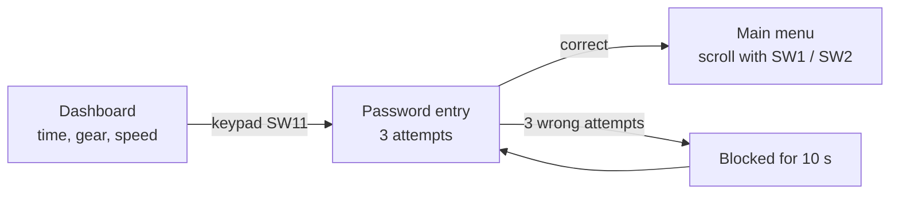

# Car Black Box

A car black box / event recorder built on the **PIC18F4580**. It shows time,
gear and speed on a 16x2 character LCD, protects access with a password, and
provides a scrolling menu for the log functions. Written in **Embedded C** with
**MPLAB X IDE and XC8**.

## Features

- **Live dashboard** on the CLCD: time from the DS1307 real-time clock, the current gear/event (`ON`, `GN`, `G1`-`G5`, `GR`, `C_`) and speed from an ADC input
- **Gear / event selection** with matrix keypad switches (up, down, collision)
- **Password protection:** the user enters the password with two keys, with 3 attempts and a 10-second lockout after failure
- **Scrolling main menu** with an arrow cursor: View log, Clear log, Download log, Set time, Change password
- **I2C drivers** for the DS1307 RTC and the AT24C04 EEPROM (used for storing events)

## Program flow



## Hardware

- PIC18F4580 at 20 MHz (`_XTAL_FREQ 20000000`)
- 16x2 character LCD (CLCD)
- 4x3 matrix keypad on PORTB
- DS1307 real-time clock (I2C)
- AT24C04 EEPROM (I2C)
- Potentiometer on ADC channel 4 for speed

## Code structure

```
car-black-box/
└── car_black_box.X/      MPLAB X project
    ├── main.c            initialisation and main loop
    ├── blackbox.c        dashboard, password, menu logic
    ├── clcd.c / .h       16x2 LCD driver
    ├── matrix_keypad.c / .h   keypad scan with state-change detection
    ├── adc.c / .h        ADC read (speed input)
    ├── i2c.c / .h        I2C master driver
    ├── ds1307.c / .h     real-time clock driver
    └── at24c04.c / .h    EEPROM driver
```

## Build and flash

1. Install **MPLAB X IDE** and the **XC8 compiler** (built with XC8 v3.10).
2. In MPLAB X, choose **File > Open Project** and open the `car_black_box.X` folder.
3. Build the project and program it onto the PIC18F4580.

## Status

Dashboard, password entry and menu navigation are implemented. The menu actions
(view, clear and download log, set time, change password) are the next steps.
[update this section as you add them]

## Demo

[add a photo or video link of the working hardware]

## What I learned

- [add: I2C communication with the DS1307 RTC and AT24C04 EEPROM]
- [add: building a menu and password system on a character LCD]
- [add: one debugging problem you solved]
