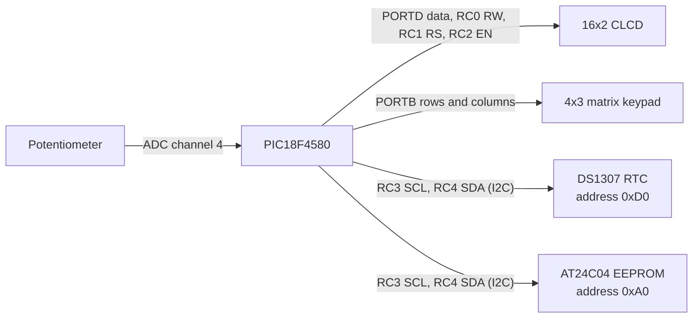

# Screens, keys and connections

This page describes what the firmware in `car_black_box.X/blackbox.c` shows on
the 16x2 CLCD and which keypad switches control it.

## 1. Dashboard (default screen)

```
  TIME   EVT SPED
10:45:30  G2   42
```

| Item | Where on the LCD | Source |
|------|------------------|--------|
| Time (HH:MM:SS) | Line 2, column 0 | DS1307 RTC over I2C |
| Event / gear | Line 2, column 9 | Keypad switches (see below) |
| Speed | Line 2, columns 14-15 | ADC channel 4 (potentiometer), scaled by `/ 10.33` |

**Event / gear keys**

| Key | Action |
|-----|--------|
| `SW1` | Gear up: `GN` -> `G1` -> `G2` -> `G3` -> `G4` -> `G5` -> `GR` |
| `SW2` | Gear down (stops at `GN`) |
| `SW3` | Collision event, shows `C_` |
| `SW1` or `SW2` after a collision | Returns to `GN` |

The event list shown on the display is: `ON`, `GN`, `G1`, `G2`, `G3`, `G4`, `G5`, `GR`, `C_`.

## 2. Password entry

Press `SW11` on the dashboard to open the password screen.

- The screen shows `ENTER PASSWORD:` with a blinking underscore cursor.
- The password is 4 key presses: `SW1` enters `0` and `SW2` enters `1`. Each press shows `*`.
- Wrong password: `WRONG PASSWORD` and `ATTEMPTS LEFT: n`.
- Correct password: `ACCESS GRANTED`, then the main menu opens.
- After 3 wrong attempts: `ACCESS DENIED!` and a `BLOCKED 10 SEC` countdown.
- The password is stored in `org_password` in `blackbox.c`.

## 3. Main menu

Two items are shown at a time with a `>` arrow at column 0.

```
> VIEW LOG
  CLEAR LOG
```

| Key | Action |
|-----|--------|
| `SW1` | Scroll down (arrow moves to line 2, then the list scrolls) |
| `SW2` | Scroll up |

Menu items: `VIEW LOG`, `CLEAR LOG`, `DOWNLOAD LOG`, `SET TIME`, `CHANGE PASSWORD`.

## Implementation status

| Feature | Status |
|---------|--------|
| Dashboard with time, event and speed | Done |
| Password entry, 3 attempts, 10 s lockout | Done |
| Menu navigation with scrolling arrow | Done |
| Menu actions (view / clear / download log, set time, change password) | Not implemented yet |
| Storing events in the AT24C04 EEPROM | Driver written, not connected to the logging flow yet |

## Pin connections (from the source code)


